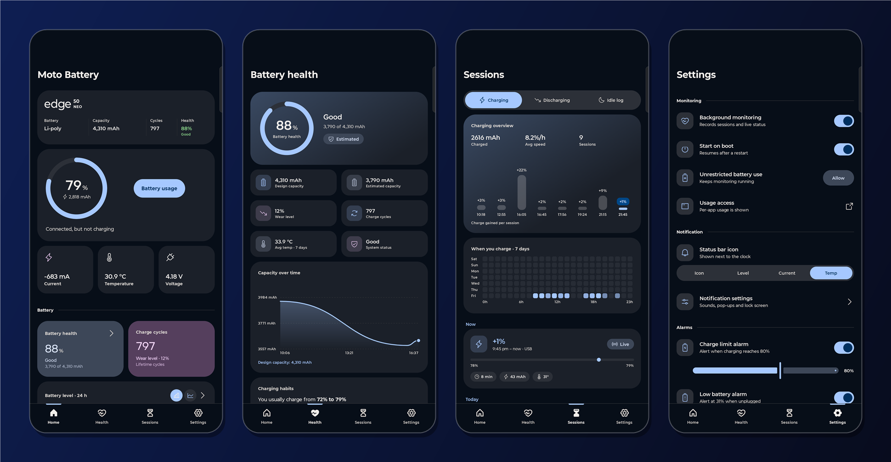
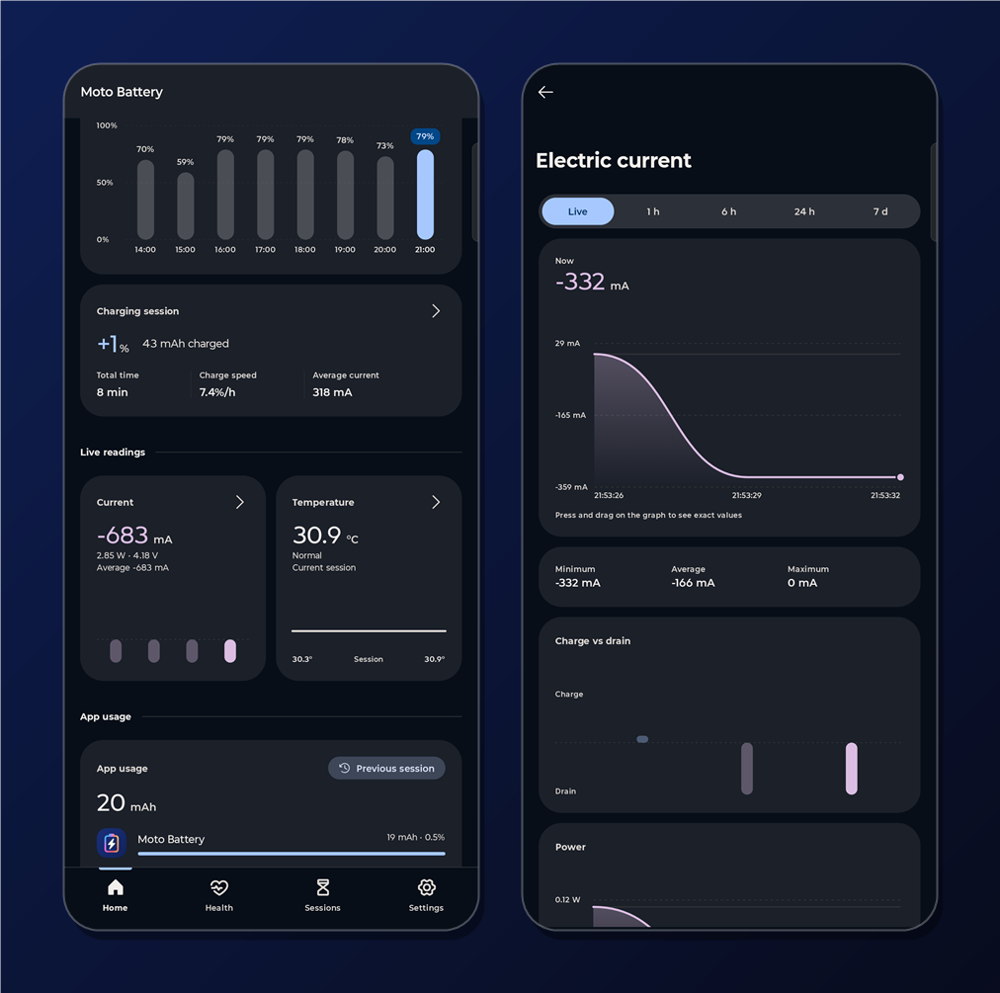
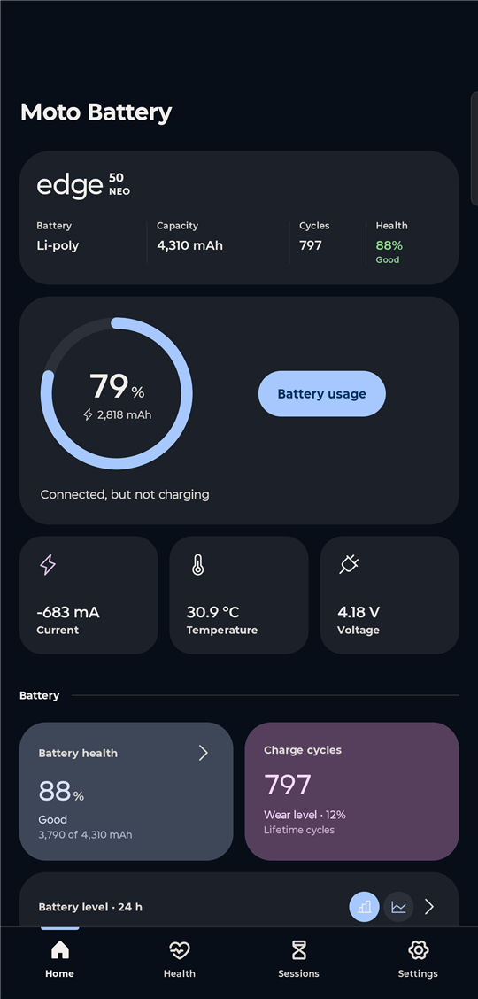
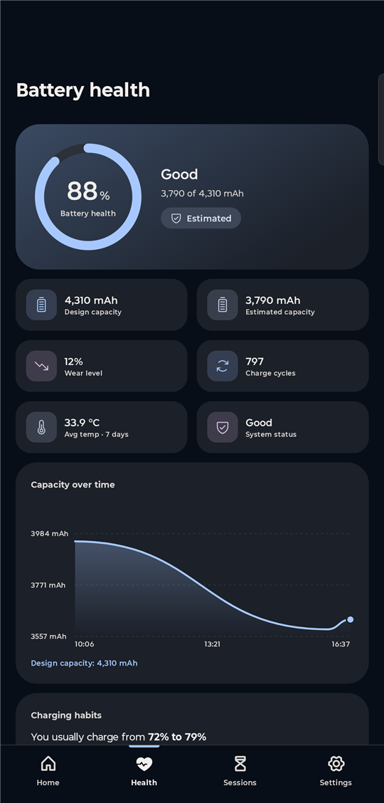
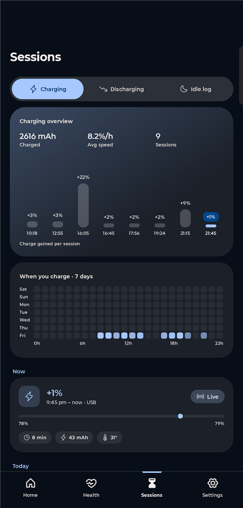
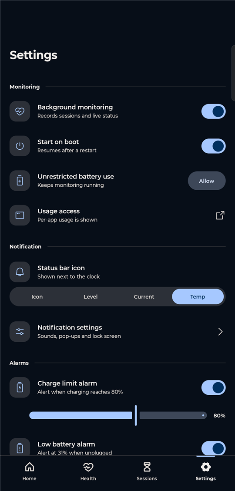

# Moto Battery

A battery monitor for Android, designed to feel at home on Motorola phones. It shows live charge,
current, temperature and voltage, estimates battery health, logs every charge, discharge and idle
period, and warns you before the battery wears faster than it needs to.



> Independent project. Not affiliated with, endorsed by or sponsored by Motorola Mobility LLC.
> "Motorola" and "moto" are trademarks of their owner and are used here only to describe the phones
> the app was designed and tested on.

## Features

- **Live readings**: level, charge counter (mAh), current (mA), power (W), temperature and
  voltage, refreshed every 3 seconds while the screen is on.
- **Battery health**: estimated capacity against design capacity, wear level, charge cycles and a
  green / amber / red rating, with a capacity-over-time chart.
- **Sessions**: every charge and discharge with its speed, mAh, duration and temperature, plus a
  heatmap of when you usually charge.
- **Idle log**: drain and deep-sleep share for each period the screen was off on battery.
- **Alarms**: charge limit (e.g. unplug at 80%), low battery and high temperature, with a short
  "tick-tick" sound and vibration.
- **Status bar icon**: shows the live level, current or temperature next to the clock.
- **Widgets and a Quick Settings tile** for battery at a glance.
- **Per-app usage**: which apps drained the most in the last session (needs usage access).
- **Interactive charts**: tap or drag on any chart to read exact values.
- **Adapts to your phone**: dynamic system colours, light/dark theme, and a type scale that adjusts
  to screen width and font size so text never wraps or gets cut off.

More screens:



| Home | Health | Sessions | Settings |
| --- | --- | --- | --- |
|  |  |  |  |

## Install

Requires Android 8.0 (API 26) or newer.

1. Open the [latest release](../../releases/latest) and download `MotoBattery-1.0.apk`.
2. Open the downloaded file on your phone. If Android asks, allow your browser or file manager to
   **install unknown apps** (Settings → Apps → Special app access → Install unknown apps).
3. Tap **Install**, then open **Moto Battery**.
4. On first launch, allow **notifications** so the live notification, status-bar icon and alarms
   can show.

Recommended after installing:

- **Settings → Unrestricted battery use → Allow**, so Android doesn't stop monitoring in the
  background.
- **Settings → Usage access**, if you want per-app battery usage.

Measurements build up over time: health estimates appear after a charge or discharge that covers
at least 15% of the battery, and the idle log after the screen has been off on battery for
15 minutes or more.

The release APK is signed with a development key. If you later install a build signed with a
different key, uninstall the old one first (this clears the app's history).

## Permissions

| Permission | Why |
| --- | --- |
| Notifications | Live battery notification, status-bar icon and alarms |
| Foreground service | Keeps sampling the battery while the app is closed |
| Start at boot | Resumes monitoring after a restart (can be turned off) |
| Vibrate | Alarm vibration |
| Ignore battery optimisations | Optional; stops the system closing the monitor |
| Usage access | Optional; per-app battery usage |

The app has no internet permission. All data stays on the phone.

## Build from source

You need JDK 17 and the Android SDK (platform 34).

```bash
git clone https://github.com/appuabm/moto-battery.git
cd moto-battery
./gradlew assembleRelease
```

The APK is written to `app/build/outputs/apk/release/app-release.apk`. Install it with:

```bash
adb install -r app/build/outputs/apk/release/app-release.apk
```

### Optional brand assets

The app can show the phone's model name in a brand typeface and a logo beside it. Those files are
not part of this repository. In your own build you can add:

- `app/src/main/res/font/moto_brand_regular.ttf` (and optionally `moto_brand_medium.ttf`)
- `app/src/main/res/drawable/moto_logo.xml`

Without them the app uses the phone's system font and shows the model name on its own. These paths
are listed in `.gitignore`, so they are never committed.

## Contributing

The code is public to read, but changes go through review. To suggest a change, fork the repository,
make your change on a branch and open a pull request. Nothing is merged without the owner's approval.

Bug reports and ideas are welcome as issues.

## Credits

- Icons: [Phosphor Icons](https://phosphoricons.com) (MIT licence) and the Material "widgets" glyph
  (Apache 2.0).
- Built with Kotlin and Jetpack Compose.

## Licence

Copyright © 2026 appuabm. All rights reserved. You may view the source and build it for personal
use; please ask before redistributing or reusing the code.
